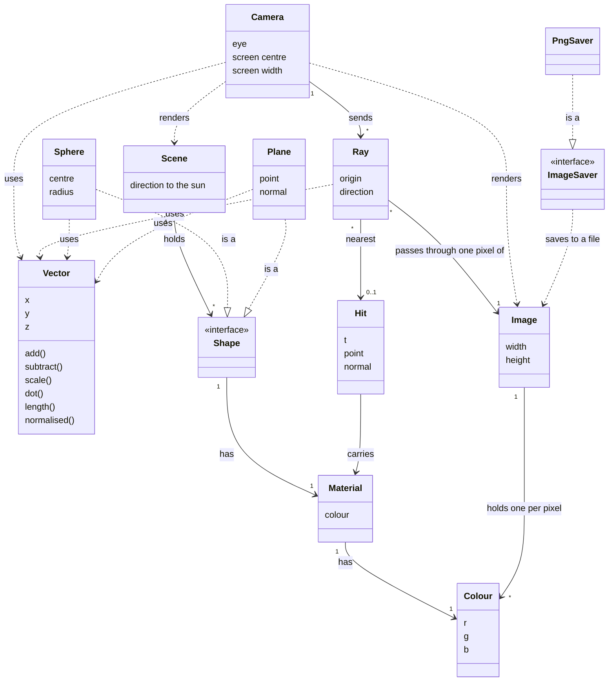

# Domain model

First model of the ray tracer, built from the client's explanation of ray tracing (milestone m1,
"Understanding the domain"). It shows the things of the domain and how they relate, not the code.

## How the renderer works

For each pixel of the image, the camera casts one ray from the eye through the pixel
(*backward tracing*). The scene finds the nearest shape the ray hits (a sphere or a plane). The
material of that shape gives the pixel its colour, lit by the sun with Lambert's law:
brightness = max(0, N·L). If the ray hits nothing, the pixel takes the background colour (black
for now). The finished image is then saved to a file by an image saver (PNG today).

## Diagram

Only `Vector` shows operations: the other boxes show what each thing knows. The colour of a pixel
is chosen by `trace` (a function, so not a box): the material of the nearest hit, shaded by the
sun, or the background colour.

## The things

| Thing  | Knows                               | Can be asked                                   |
|--------|-------------------------------------|------------------------------------------------|
| Vector | x, y, z                             | add, subtract, scale, dot, length, normalised  |
| Ray    | an origin, a direction              | the point at distance t: P(t) = O + t·D, t ≥ 0 |
| Shape  | nothing: it is a role (sphere, plane) | the nearest hit of a ray in front of its origin, or nothing |
| Sphere | a centre, a radius, a material      | where a ray hits it: t, point, unit normal      |
| Plane  | a point, a unit normal, a material  | where a ray hits it: t, point, unit normal      |
| Hit    | t, the point, the unit normal, the material | (data only)                            |
| Material | a colour                          | the colour seen for a normal and a light: max(0, N·L) × colour |
| Scene  | the shapes, the direction to the sun | the nearest hit of a ray among all shapes     |
| Camera | the eye, the screen centre and width | the ray through a given pixel: D = pixel − eye; render a scene to an image |
| Image  | a width, a height, a colour per pixel | the colour of a pixel; set it                 |
| ImageSaver | nothing: it is a role           | save an image to a file                        |
| PngSaver | how to write PNG (through LodePNG) | save an image as a PNG file                   |
| Colour | r, g, b between 0 and 1             | its r, g, b; scaled by a number                |

## Decisions

The model left three questions open. Each one is recorded in an ADR:

| Question                                    | Decision                                  | ADR |
|---------------------------------------------|-------------------------------------------|-----|
| Is a colour a vector?                       | No: `Colour` is its own class             | [0006](../adr/0006-colour-is-not-a-vector.md) |
| Are points and directions the same class?   | Yes: both are `Vector`                    | [0007](../adr/0007-points-and-directions-are-vectors.md) |
| Who decides the colour of a pixel?          | A `trace` function, not the camera, shape or image | [0008](../adr/0008-who-colours-the-pixel.md) |

Later decisions that shaped the model:

| Question                                    | Decision                                  | ADR |
|---------------------------------------------|-------------------------------------------|-----|
| Which way do the axes point?                | x right, y up, z away from the eye; pixel rows go down | [0010](../adr/0010-coordinate-system.md) |
| How do we write image files?                | PNG with LodePNG, behind `ImageSaver`     | [0011](../adr/0011-png-with-lodepng.md) |
| How do a shape and a material relate?       | A shape has a material (composition)      | [0012](../adr/0012-a-shape-has-a-material.md) |
